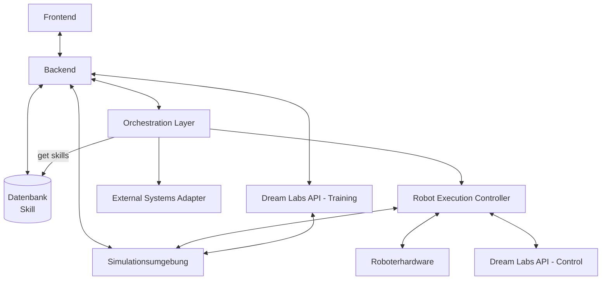
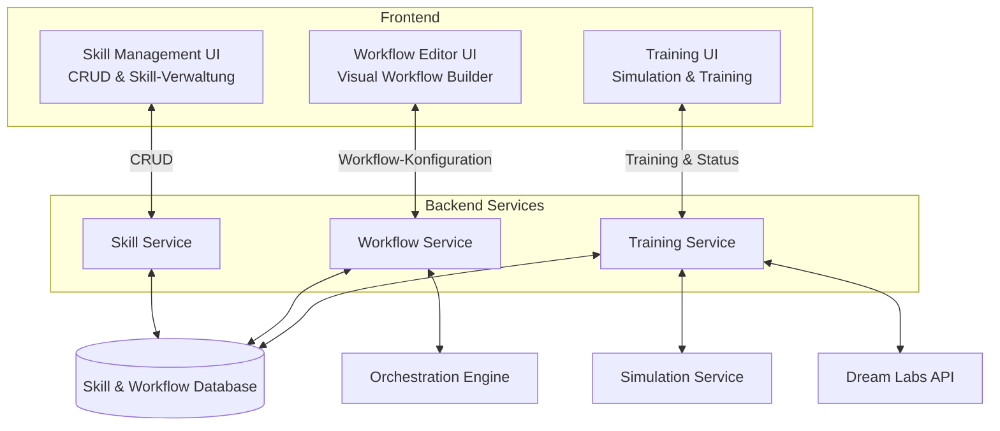
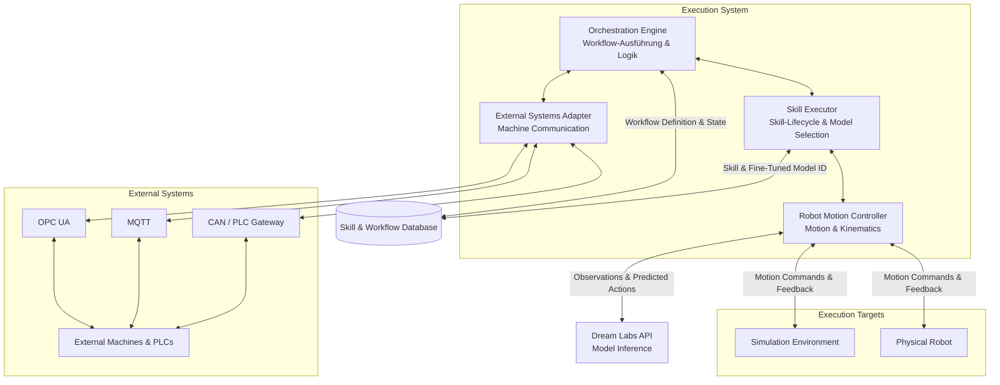
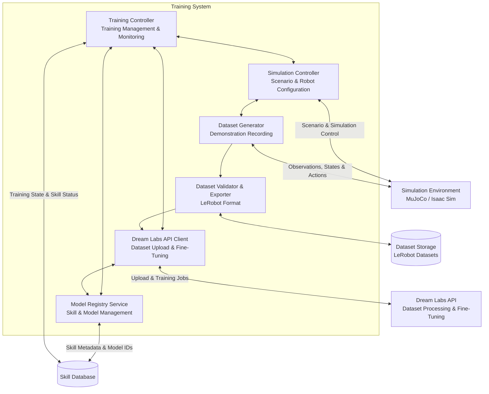

# Dream Orchestrator - Konzept

## 1. Einführung und Use Case

### 1.1 Ausgangssituation und Ziel

Die Plattform ermöglicht es, **wiederverwendbare Robotik-Skills** anzulegen, mit **simulierten Demonstrationsdaten** für Dream-1 zu fine-tunen und anschließend über eine **visuelle Workflow-Engine** zu vollständigen Automatisierungsabläufen zu verbinden. Externe Maschinen werden über konfigurierbare Aktionsblöcke eingebunden.

**Ziel:** Robotik-Automatisierung ohne eigene KI-Trainingsinfrastruktur einfacher konfigurieren, trainieren, kombinieren und ausführen.

### 1.2 Zielgruppen

- **Robotikentwickler und Integratoren:** Roboterfähigkeiten entwickeln und in Anlagen einbinden.
- **Automatisierungs- und Produktionsunternehmen:** Abläufe aus Robotik- und Maschinenschritten konfigurieren.
- **Forschungs- und Prototyping-Teams:** Skills mit Simulationsdaten testen und iterativ verbessern.

### 1.3 Beispiel-Use-Case

Ein Roboter soll ein Werkstück greifen, in eine Prüfstation legen und nach einem externen Prüfsignal sortieren. Dafür werden die Skills **„Greifen“**, **„Ablegen“** und **„Sortieren“** separat verwaltet und bei Bedarf individuell fine-getunt. Der Workflow verbindet die Skills mit **Warten auf Prüfsignal**, **Wenn/Dann-Verzweigung** und **Wiederholung**.

## 2. Anforderungen

Prioritäten: **M** = Pflicht für die Demo, **S** = sollte, **K** = Kür

### Editor

| ID | Prio | Anforderung                                                                                                                                                     |
|----|------|-----------------------------------------------------------------------------------------------------------------------------------------------------------------|
| F1 | M    | Blöcke auf einer Fläche platzieren und mit Pfeilen verbinden. Blocktypen: *Start*, *Dream-1-Prompt*, *Warte auf Sensor*, *Aktor setzen*, *Warte (Zeit)*, *Ende* |
| F2 | M    | Block *Bedingung* (wenn Sensor X, dann Pfad A, sonst B) und Pfeile zurück zu früheren Blöcken. Pick-and-Place braucht die Schleife „nächstes Objekt“.           |
| F3 | M    | Abläufe als JSON-Datei speichern und laden                                                                                                                      |
| F4 | M    | Prüfung vor dem Start: genau ein Start-Block, keine losen Blöcke, kein leerer Prompt                                                                            |

### Ausführung

| ID | Prio | Anforderung                                                                                                                                                                  |
|----|------|------------------------------------------------------------------------------------------------------------------------------------------------------------------------------|
| F5 | M    | Ablauf starten; der aktive Block wird hervorgehoben                                                                                                                          |
| F6 | M    | Prompt-Block: Prompt an die API senden, Status abfragen, bei „erfolgreich“ weiter. Es gibt ein Zeitlimit pro Block, und Fehler führen auf einen Fehlerpfad oder zum Abbruch. |
| F7 | M    | Stopp-Knopf, der immer sichtbar ist: bricht den Ablauf ab und stoppt den laufenden Simulationslauf über die API                                                              |
| F8 | S    | Pause und Einzelschritt                                                                                                                                                      |
| F9 | S    | Wiederholungen pro Prompt-Block, falls ein Lauf fehlschlägt                                                                                                                  |

### Virtuelle Sensoren und Aktoren

| ID  | Prio | Anforderung                                                                                                                                                                                        |
|-----|------|----------------------------------------------------------------------------------------------------------------------------------------------------------------------------------------------------|
| F10 | M    | Eine Geräteleiste mit virtuellen Sensoren (Schalter, Taster, Zahlenwert), die der Nutzer bedient, und Aktoren (Lampe, Förderband an/aus), die der Ablauf schaltet                                  |
| F11 | M    | Eine Geräte-Schnittstelle: Jedes Gerät hat Name, Typ und Wert und dazu einen Adapter. Für den Hackathon gibt es nur den Adapter „virtuell“; später kommen echte Geräte als weiterer Adapter hinzu. |
| F12 | S    | „Warte auf Sensor“ mit Bedingung (zum Beispiel `Lichtschranke == an`) und eigenem Zeitlimit                                                                                                        |
| F13 | K    | Ein zweiter Adapter (zum Beispiel MQTT) als Beleg, dass echte Geräte wirklich anschließbar sind                                                                                                    |

### Überwachung

| ID  | Prio | Anforderung                                                                                               |
|-----|------|-----------------------------------------------------------------------------------------------------------|
| F14 | M    | Ein Ablaufprotokoll mit Zeitstempel, Block, API-Status und Dauer                                          |
| F15 | S    | Ein Credit-Zähler pro Ablauf und vor dem Start eine Schätzung (Anzahl der Prompt-Blöcke × Wiederholungen) |
| F16 | K    | Die Dream-Labs-Simulationsansicht verlinken oder einbetten                                                |
| F17 | K    | Eine KI schlägt aus einem Ziel einen ersten Ablauf vor                                                    |

## Nicht-funktionale Anforderungen

- **N1:** Der API-Key steht nur in der `.env`, nie in der Oberfläche, im Protokoll oder im Code.
- **N2:** Es gibt einen Testmodus für die API: ein Stellvertreter, der Statusantworten nachspielt. So entwickelt man ohne Credits und ohne auf die echte API zu warten. Damit die Demo nichts vortäuscht, zeigt die Oberfläche ihn deutlich als „SIMULIERTE API“ an; in der Demo läuft die echte API.
- **N3:** Die Ablauf-Engine ist von der Oberfläche getrennt und mit `pytest` testbar.
- **N4:** API-Fehler und Zeitüberschreitungen bringen das Programm nicht zum Absturz, sondern erscheinen im Protokoll.
- **N5:** Der Abstand zwischen zwei Statusabfragen ist einstellbar, damit keine Ratenlimits gerissen werden.
- **N6:** Das Tool startet lokal mit einem Befehl, auf Basis des vorhandenen Docker-Setups.

## 3. Systemarchitektur

### 3.1 Frontend – Komponentendiagramm

### 3.2 Execution – Komponentendiagramm

### 3.3 Training – Komponentendiagramm

## 4. Komponentenübersicht

Die Komponenten werden zunächst nur aufgeführt; ihre detaillierten Schnittstellen und internen Abläufe sind nicht Teil dieser Version.

1. Frontend
2. Backend
3. Datenbank
4. Dream Labs API
5. Simulationsumgebung / Trainingsdaten-Erzeugung
6. Orchestration Layer
7. Robot Execution Controller
8. External Systems Adapter

## 5. Datenmodell

In dieser Konzeptversion wird **nur ein fachliches Datenmodell** spezifiziert:

### Skill

| Feld               | Typ (Vorschlag)   | Beschreibung                                                |
|--------------------|-------------------|-------------------------------------------------------------|
| `name`             | String            | Eindeutiger, sprechender Name des Skills                    |
| `description`      | Text              | Aufgabe und gewünschtes Verhalten                           |
| `created_at`       | DateTime          | Erstellungsdatum                                            |
| `status`           | Enum              | Z. B. `Entwurf`, `Training`, `Bereit`, `Fehler`             |
| `fine_tuned_model` | String / nullable | Name, Modell-ID oder Pfad des fine-getunten Dream-1-Modells |

Ein Skill kann zunächst ohne fine-getuntes Modell angelegt werden; die Modellreferenz wird nach erfolgreichem Training ergänzt. Weitere Datenmodelle (z. B. Workflow oder Connector) bleiben vorerst offen.

## 6. Integration

### 6.1 Dream Labs API

- Authentifizierung und Zugriff über das offizielle SDK bzw. die API.
- Embodiment-Konfiguration und Trainingsdatensatz registrieren bzw. hochladen.
- Fine-Tuning asynchron starten, Status abfragen und die resultierende Modell-ID am Skill hinterlegen.
- Bei der Skill-Ausführung das passende Modell für die Inferenz verwenden.

### 6.2 Training und Simulationsumgebung

- Zunächst **rein simulierte** Roboterszenarien (z. B. MuJoCo oder Isaac Sim).
- Erfolgreiche Demonstrationen erzeugen (Expert-Controller/Teleoperation), mit Kamera-, Zustands-, Aktions- und Zeitdaten aufzeichnen.
- Datensätze in ein von Dream Labs unterstütztes LeRobot-Format exportieren und vor dem Upload validieren.
- Trainierte Skills in zurückgehaltenen Simulationsszenarien testen; Sim-to-Real ist nicht Voraussetzung des MVP.

### 6.3 Robotik / Robot Execution Controller

- Einheitliche Schnittstelle zum Starten, Überwachen und Stoppen einer Skill-Ausführung.
- Übertragung der von Dream-1 berechneten Aktionen an den Robotercontroller oder Simulator; Rückmeldung von Status und Fehlern.
- Hardwareabhängige Kinematik, Regelung und Sicherheitsfunktionen bleiben im Robot Execution Controller bzw. in der Robotersteuerung.

### 6.4 Externe Systeme und Maschinen

- Konfigurierbare Aktionsblöcke für **Signal senden**, **Signal lesen** und **auf Signal warten**.
- Adapterkonfiguration: Protokoll (z. B. **OPC UA, MQTT, HTTP, CAN**), Endpoint, Adresse/Topic/Objekt-ID, Authentifizierung, Datentyp, Payload-Mapping und Timeout.
- Anbindung von **SPS/PLC** über das jeweils unterstützte Kommunikationsprotokoll; SPS ist selbst kein Protokoll.
- Eingehende Signale und Ergebnisse werden im Workflow für Bedingungen und Folgeaktionen verfügbar.

---

**Abgrenzung:** Die Plattform orchestriert Skills und Maschinen, ersetzt aber keine sicherheitsgerichtete SPS oder Robotersteuerung. Die Ausführung mit realer Hardware ist eine spätere Ausbaustufe; das Hackathon-MVP kann vollständig simuliert laufen.